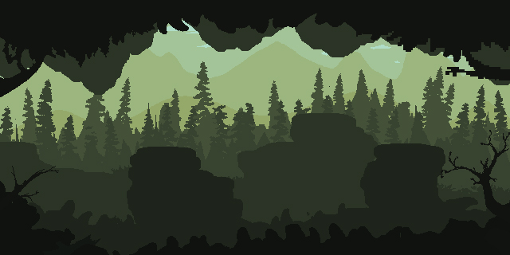

# 🏰 Gulungan Takdir | Magical World

<p align="center">
  
</p>

<h3 align="center">✦ A Journey Written in Code, Sealed by Magic ✦</h3>

<p align="center">
  An Interactive Medieval Fantasy Portfolio & Digital Gift Experience
</p>

<p align="center">
  
  
  
  
  
</p>

---

## 📜 About The Project

**Gulungan Takdir (Magical World)** adalah sebuah website portofolio interaktif sekaligus *digital gift* yang mengusung tema **Medieval Fantasy / Dark Fantasy**.

Proyek ini dirancang untuk menghadirkan pengalaman menjelajahi sebuah dunia fantasi melalui perjalanan seorang **"Penyihir Kode"**. Setiap halaman merepresentasikan bagian dari perjalanan hidup, pencapaian, kenangan, kemampuan, dan impian yang tersimpan dalam sebuah dunia magis.

Bukan sekadar portofolio biasa, website ini menggabungkan elemen visual sinematik, animasi 3D, interaksi modern, dan atmosfer RPG klasik untuk menciptakan pengalaman digital yang lebih imersif.

> *"Every journey has a story. Every story has a destiny. And every destiny is written in code."*

## ✨ Features & Magical Elements

Website ini memiliki berbagai elemen interaktif yang dirancang untuk membangun pengalaman eksplorasi dunia fantasi.

### ⏳ 1. Interactive 3D Countdown
- Countdown interaktif menuju hari ulang tahun.
- Efek hover 3D untuk memberikan pengalaman visual yang dinamis.
- Tooltip elegan yang menampilkan informasi tanggal secara lengkap.

### 📖 2. The Grimoire | Magical Book
- Buku sihir 3D interaktif dengan simulasi rotasi dan animasi membuka buku.
- Menampilkan informasi kemampuan (*skills*) dan ringkasan jurnal.
- Menghadirkan nuansa buku kuno dalam dunia fantasi.

### 🗺️ 3. Ancient Map | Map of Destiny
- Peta perjalanan hidup dengan desain gulungan perkamen kuno.
- Jalur perjalanan menggunakan *dotted path*.
- Ornamen dekoratif bertema petualangan, termasuk monster laut.

### 🛡️ 4. Guild Academy | Quest Board
- Papan misi bergaya RPG klasik.
- Menampilkan riwayat pendidikan dan perjalanan akademik.
- Memuat informasi SMP Bina Mulia dan SMK jurusan Rekayasa Perangkat Lunak (RPL).

### 📸 5. Memory Gallery
- Galeri foto dengan konsep *Polaroid*.
- Ornamen selotip emas dan tampilan foto bergaya scrapbook.
- Menampilkan dokumentasi dan kenangan perjalanan hidup.

### ✉️ 6. Secret Letter
- Surat rahasia dengan desain gulungan perkamen.
- Animasi interaktif untuk membuka dan menutup surat.
- Menampilkan pesan personal dalam suasana medieval.

### 🎵 7. Ambient Sound Experience
- Background ambience bertema hutan dan angin.
- Kontrol untuk mengaktifkan atau menonaktifkan audio.
- Memberikan atmosfer eksplorasi yang lebih mendalam.

### 🔔 8. Medieval Notification System
- Sistem notifikasi kustom dengan ornamen emas.
- Tipografi bergaya klasik.
- Animasi notifikasi yang muncul secara interaktif dari sudut layar.

---

## 🛠️ Tech Stack

Proyek ini dibangun menggunakan ekosistem modern React dan teknologi visual 3D.

| Technology | Description |
|---|---|
| [Next.js 14](https://nextjs.org/) | React Framework dengan App Router |
| [React](https://react.dev/) | Library untuk membangun antarmuka |
| [TypeScript](https://www.typescriptlang.org/) | Type-safe JavaScript |
| [Tailwind CSS](https://tailwindcss.com/) | Utility-first CSS framework |
| [Framer Motion](https://www.framer.com/motion/) | Animasi dan transisi UI |
| [Three.js](https://threejs.org/) | Rendering grafis 3D |
| [React Three Fiber](https://docs.pmnd.rs/react-three-fiber/getting-started/introduction) | Integrasi Three.js dengan React |
| [Drei](https://github.com/pmndrs/drei) | Helper utilities untuk React Three Fiber |
| [Sonner](https://sonner.emilkowal.ski/) | Sistem notifikasi Toast |
| [canvas-confetti](https://www.kirilv.com/canvas-confetti/) | Efek animasi confetti |
| [Lucide React](https://lucide.dev/) | Library ikon |

---

## 🚀 Getting Started

Ikuti langkah-langkah berikut untuk menjalankan proyek secara lokal.

### Prerequisites

Pastikan perangkatmu sudah memiliki:

- [Node.js](https://nodejs.org/) (disarankan versi LTS).
- npm, yarn, atau pnpm.
- Git.

### Installation

**1. Clone Repository**

```bash
git clone https://github.com/username-kamu/gulungan-takdir.git
```

**2. Masuk ke Direktori Proyek**

```bash
cd gulungan-takdir
```

**3. Install Dependencies**

```bash
npm install
```

**4. Jalankan Development Server**

```bash
npm run dev
```

**5. Buka Website**

Akses alamat berikut melalui browser:

```text
http://localhost:3000
```

Selamat datang di dunia Gulungan Takdir! 🏰

---

## 📂 Project Structure

Berikut gambaran struktur direktori utama proyek:

```text
gulungan-takdir/
│
├── app/
│   ├── page.tsx             # Main page
│   ├── layout.tsx           # Root layout & font configuration
│   │
│   ├── gift/                # Treasure Chest page
│   ├── journey/             # 3D Artifact Gallery
│   ├── letter/              # Secret Letter page
│   └── wishes/              # Guestbook page
│
├── components/
│   ├── PixelCastle.tsx      # Castle background & waving flags
│   ├── MagicBook3D.tsx      # Interactive 3D Grimoire
│   ├── Cake3D.tsx            # 3D Treasure Chest component
│   ├── FloatingGallery.tsx  # 3D Photo Gallery
│   └── CustomToast.tsx      # Custom notification component
│
├── public/
│   ├── kastil.jpg           # Castle background image
│   ├── ambience.mp3          # Ambient background audio
│   └── photos/              # Gallery images
│
├── package.json
├── package-lock.json
├── next.config.js
├── tailwind.config.ts
├── tsconfig.json
└── README.md
```

*Catatan: Struktur di atas merupakan gambaran direktori utama. File tambahan dapat berbeda sesuai perkembangan proyek.*

---

## 🎨 Customization Guide

Ingin mengubah beberapa elemen di dalam dunia Gulungan Takdir? Berikut panduannya.

### 1. Change Birthday Countdown

Buka file:

```text
app/page.tsx
```

Cari variabel `targetDate`:

```typescript
const targetDate = new Date(
  '2026-12-21T00:00:00+07:00'
).getTime();
```

Ubah tanggal sesuai kebutuhan menggunakan format:

```text
YYYY-MM-DDTHH:mm:ss+07:00
```

### 2. Update School Information

Untuk mengubah informasi pendidikan:

- Buka `app/page.tsx`.
- Cari bagian **Guild Academy / Quest Board**.
- Sesuaikan informasi sekolah, deskripsi, dan gambar.

### 3. Update Memory Gallery

Untuk mengganti foto galeri:

- Siapkan foto yang ingin digunakan.
- Simpan gambar ke direktori `public/photos/`.
- Sesuaikan referensi gambar pada bagian galeri di `app/page.tsx`.

### 4. Add Ambient Audio

Siapkan file audio bernama:

```text
ambience.mp3
```

Kemudian letakkan di:

```text
public/ambience.mp3
```

Untuk mendapatkan audio bebas royalti, kamu dapat menjelajahi [Pixabay Sound Effects](https://pixabay.com/sound-effects/search/nature/).

Pastikan untuk memeriksa ketentuan lisensi setiap audio sebelum digunakan.

---

## 🌐 Deployment

Website ini dapat dipublikasikan menggunakan [Vercel](https://vercel.com/).

### Deployment Steps

1. Push seluruh source code ke repository GitHub.
2. Masuk ke Vercel dan hubungkan akun GitHub.
3. Pilih repository `gulungan-takdir`.
4. Tunggu proses deployment dan build selesai.
5. Website akan mendapatkan URL publik dari Vercel.

Untuk dokumentasi lebih lanjut, kunjungi [Vercel Documentation](https://vercel.com/docs).

---

## 📌 Project Information

| Information | Details |
|---|---|
| Project Name | Gulungan Takdir |
| Codename | Magical World |
| Project Type | Interactive Portfolio & Digital Gift |
| Theme | Medieval Fantasy / Dark Fantasy |
| Framework | Next.js 14 |
| Language | TypeScript |
| Developer | Fajri / HafzDev |
| Website | [hafzdev.web.id](https://hafzdev.web.id/) |

---

## 📄 License

Proyek ini dikembangkan untuk keperluan personal sebagai portofolio kreatif dan *digital gift*.

Source code dapat dipelajari dan dimodifikasi sesuai kebutuhan. Namun, aset visual, audio, maupun materi pihak ketiga tetap mengikuti lisensi dan ketentuan pemilik masing-masing.

---

<p align="center">
  <b>⚜️ Crafted with Code, Imagination & A Little Bit of Magic ⚜️</b>
  <br />
  <br />
  Made with ❤️ by <a href="https://hafzdev.web.id/">Fajri / HafzDev</a>
  <br />
  <i>"The story never ends. It only turns to another page."</i>
</p>
